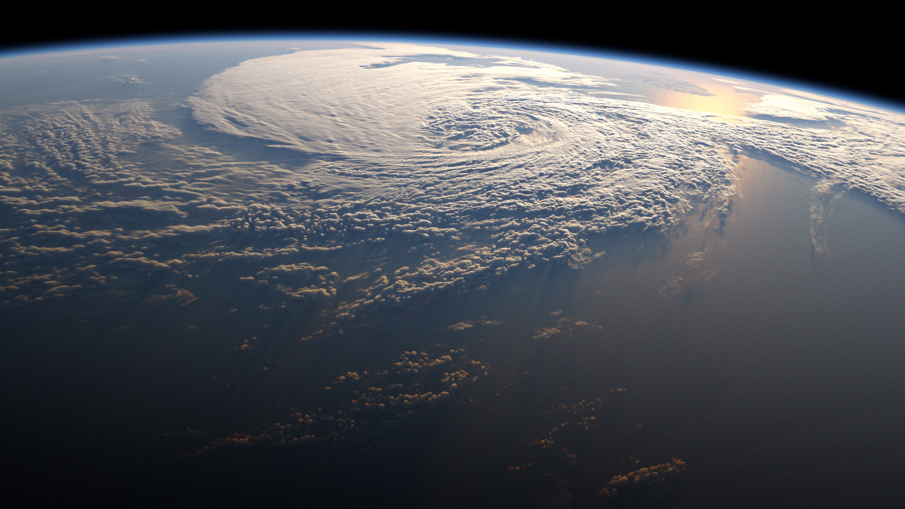
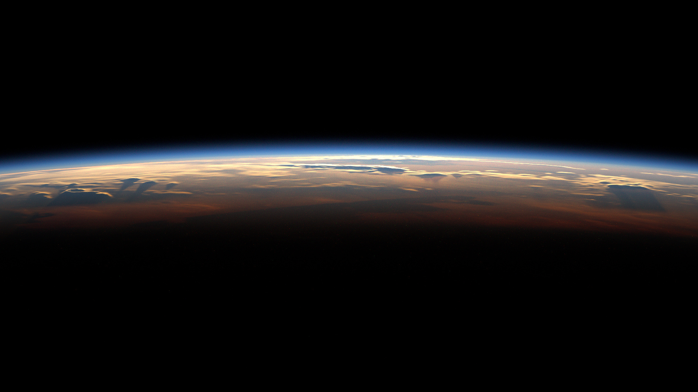
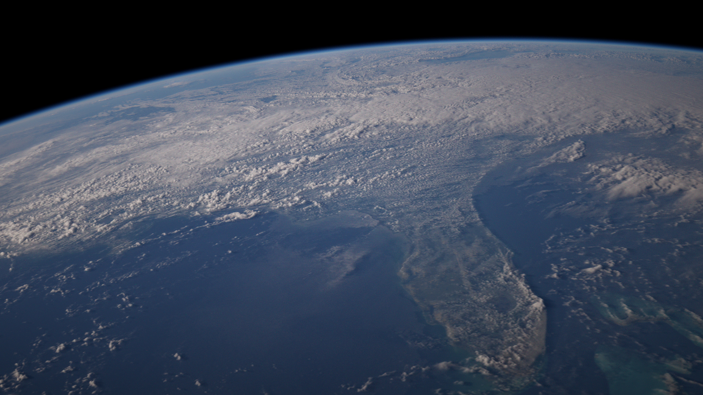

# <a name="title">Digital Earth</a>
Demo shots             |  1080p
:-------------------------:|:-------------------------:
 | 
 | 

More renders are in [`screenshot/`](screenshot), and renders through
different camera responses in [`screenshot/Film comparison/`](screenshot/Film%20comparison).

## Overview

A spectral renderer of the Earth seen from space. The host is written in Zig,
and the rendering runs in Slang compute kernels on Vulkan or Metal through
[slang-rhi](https://github.com/shader-slang/slang-rhi).

The physics, shared by every render mode:

+ Participating media with measured densities and spectral responses
  (extinction coefficients and phase functions) of atmospheric gases:
  + Rayleigh scatterers: nitrogen (N2), oxygen (O2), carbon dioxide (CO2)
  + Mie scatterers: water vapour
  + Other absorbers: ozone (O3), with the global annual mean profile of the
    McPeters and Labow 2011 climatology ([doi:10.1029/2011JD017006](https://doi.org/10.1029/2011JD017006),
    Aura MLS and ozonesondes, 292 DU) and the 223 K absorption cross sections of
    Serdyuchenko et al. 2014 ([doi:10.5194/amt-7-625-2014](https://doi.org/10.5194/amt-7-625-2014));
    the sources and their generators are in `LUT/` and `python/lut/`. The
    `bruneton` table and the trained networks predate this ozone and need a
    rebake and retraining.
+ NASA maps for ground albedo, water bodies, topography, bathymetry, clouds,
  night lights, and stars. Land is a heightfield, and clouds are a volumetric
  shell.
+ Spectral rendering: wavelengths drawn from the CIE 1931 colour-matching
  functions and accumulated in linear Rec.709. The path tracer and the ray
  marcher carry four per sample, stratified over the CIE CDF; the path tracer
  weights them by hero-wavelength spectral MIS.
+ [OpenDRT](https://github.com/jedypod/open-display-transform) for the HDR to
  SDR transform, then a measured camera response function for a filmic look.

The papers behind the media models are in [`academic sources/`](academic%20sources).

## Requirements

- A GPU with Vulkan 1.3 (Linux, Windows) or Metal (macOS). The textured scene
  at texture quality Q2 needs about 2.5 GB of video memory; Q1 needs less.
- [pixi](https://pixi.sh), which installs everything else: Zig 0.17, CMake,
  Ninja, a C++ compiler, SDL3, and the Vulkan loader.
- On Linux, an X11 session or XWayland.

## Quick start

```bash
pixi run build    # the first build compiles slang-rhi and takes a few minutes
```

Download the NASA textures from
[Google Drive](https://drive.google.com/drive/folders/1RPspOXGj9JEV4nX78C5mGNWEgzic9dsv?usp=sharing)
into `textures/`, decode them once into the cache the renderer reads, and
start the viewer from the repository root:

```bash
./zig-out/bin/earth bake-textures --texture-quality q2    # or q1, or both
./zig-out/bin/earth view --config presets/apollo-11.zon
```

Without baked textures the viewer still runs the `symmetric` scene preset.

## Command line

```
earth [command] [options]
```

| Command | What it does |
| --- | --- |
| `view` (default) | interactive viewer |
| `render` | headless render to a PNG |
| `bake-textures` | decode the NASA PNGs into `<data>/cache/` |
| `datagen` | MLP training data and scattering tables from the symmetric path tracer |

Options for every command:

| Option | Meaning |
| --- | --- |
| `--backend vulkan\|metal\|d3d12` | GPU backend (default: the platform's choice) |
| `--validation` | GPU validation layers (always on in Debug builds) |
| `--data <dir>` | the [data root](#data-root) (default: the working directory) |
| `--config <file.zon>` | initial settings, e.g. `presets/florida.zon` (default: built-in) |
| `--weights <file.emlp>` | [network](#networks) of the `neural` mode (default: `<data>/cache/mlp/mlp_e120.emlp`, if present) |
| `--lut <file.edgn>` | [scattering table](#scattering-table) of the `bruneton` mode (default: `<data>/cache/lut/scattering.edgn`, if present) |
| `--texture-quality q1\|q2` | Earth map set to render or bake (default: the config's) |
| `--help` | usage |

`render` options:

| Option | Meaning |
| --- | --- |
| `--mode debug\|path_tracer\|raymarch\|neural\|bruneton` | render mode (default: the config's) |
| `--preset textured\|symmetric` | scene preset (default: the config's) |
| `--width <px> --height <px>` | image size (default: 1920 x 1080) |
| `--spp <n>` | samples per pixel (default: 64) |
| `--out <file.png>` | output image (default: `render.png`) |
| `--out-linear <file.pfm>` | also the mean linear Rec.709 samples, before the display transform |
| `--single-scattering` | light scatters once only: one bounce in every mode, and `raymarch` drops its multiple-scattering table; for accuracy studies of the modes against each other |
| `--seed <n>` | first frame of the random-number key (default: 0); renders seeded `--spp` apart are independent, for noise measurements |

`bake-textures` takes `--source <dir>`, the PNG directory (default:
`<data>/textures`). Paths given on the command line are relative to the working
directory, not the data root.

A quick ray-marched preview:

```bash
./zig-out/bin/earth render --config presets/apollo-11.zon --mode raymarch --width 960 --height 540 --out apollo.png
```

## Controls

| Input | Action |
| --- | --- |
| right mouse drag | rotate the camera |
| `W` `A` `S` `D` | move; the speed scales with altitude |
| `Space` / left `Ctrl` | move up / down |
| left `Shift` | move three times faster |
| `Q` | turn the camera's up to the planet's surface normal |
| `E` | reset the camera's up to world +Y |
| `R` | teleport to 100 m above the point below the camera |
| `G` | show or hide the panel |
| `I` / `O` | save / load `<data>/config.zon` |
| `P` | save a screenshot to `<data>/screenshots/` |

The panel selects the mode, scene preset, texture quality, and the `neural`
mode's network (`rescan` relists `<data>/cache/neural/`), and sets the sun
angle and path, field of view, and the [display](#display) settings. Its
`load config` button picks any `.zon` config, such as a preset, in a file
dialog. Changes that alter the image restart the accumulation. Display settings
apply to the samples already accumulated.

## Display

The display pass takes the mean of the accumulated samples through the
vignette, exposure, [OpenDRT](https://github.com/jedypod/open-display-transform)
v1.0.0b43, the camera response, gamma, and the sRGB OETF. OpenDRT maps
scene-linear Rec.709 to display-linear Rec.709 in [0, 1] with its Default look;
the camera response and gamma act on those display-linear values, and the sRGB
OETF is the only encoding. Every mode shares the settings below:

| Setting | Default | Effect |
| --- | --- | --- |
| `saturation` | 1.2 | Oklab chroma scale ahead of OpenDRT; 1 keeps OpenDRT's look, 0 is greyscale |
| `contrast` | 0 | added to the tonescale's contrast power, which stays at least 0.25 |
| `tonescale` | `dagrinchi_tone` | one of OpenDRT's seven tonescale presets |

The look has Hue Shift R, G, and B at 0.15, 0.2, and 0.2 instead of upstream's
0.35. [`python/opendrt.py`](python/opendrt.py) is a float64 port of the
upstream DCTL that the shader is tested against.

## Modes and presets

Render modes:

- `path_tracer`: spectral volumetric path tracing, up to 25 bounces. The
  reference, and the slowest to converge.
- `raymarch`: single scattering along the view ray plus a multiple-scattering
  lookup table (Hillaire 2020), baked on the GPU at startup and whenever the
  scene preset changes. Its steps crowd into dense air, placed by a coarse
  optical-depth estimate of each segment, and each sample marches four
  wavelengths at once. Converges in a few samples.
- `neural`: a trained network maps each pixel's ray to the radiance of the
  atmosphere: a plain MLP, or Fourier features, a hash grid, or K-Planes in
  front of a small one. Needs a [network](#networks).
- `bruneton`: the same per-ray mapping, with the network replaced by a dense
  table of path-traced radiance, interpolated quadrilinearly (Bruneton and
  Neyret 2008). Needs a [scattering table](#scattering-table).
- `debug`: a sun-lit Lambertian sphere without atmosphere, for checking the
  camera and the display pipeline.

Scene presets:

- `textured`: the Earth with NASA maps, heightfield land, clouds, and stars
  (night lights are disabled for now). The panel's `clouds` checkbox (config `clouds`, `render --no-clouds`)
  removes the cloud shell; only `path_tracer` renders clouds. Needs baked textures. Only `path_tracer` and `raymarch` read them,
  so they are uploaded when one of those modes first runs.
- `symmetric`: a smooth grey sphere under a clear atmosphere, the scene the networks
  are trained on and the scattering table holds. `neural` and `bruneton` render it
  whatever the preset.

Both presets share one atmosphere and one light transport (aerosol phase
Klein-Nishina on the first scatter and Henyey-Greenstein after it, up to 25
bounces); they differ in scene content only.

The config presets in [`presets/`](presets) (`apollo-11.zon`, `florida.zon`,
`sunset-hurricane.zon`) set the camera, sun, scene preset, and display
settings. The viewer saves its state in the same format.

## Data root

Every runtime file lives under the data root, `--data <dir>`. It defaults to
the working directory, which in a checkout is the repository root:

```
LUT/                      spectral tables and camera response functions (tracked)
textures/                 NASA PNGs from the Google Drive folder
cache/earth/q1|q2/*.raw   baked Earth maps, written by `earth bake-textures`
cache/mlp/mlp_e120.emlp   the default network
cache/neural/*.emlp       networks the viewer offers
cache/lut/scattering.edgn the default scattering table
presets/                  config presets (tracked)
screenshots/              viewer screenshots
config.zon                the viewer's saved state (I / O)
```

## Networks

The `neural` mode reads an EMLP file (layout in `src/assets/Network.zig`):
the input encoding with its tables, whether u_mu is rotated by half, the output
scale, and the dense layers. `python/export_weights.py` writes one from a
`python/model.py` checkpoint or from an encoding-study run, and checks it
against torch first:

```bash
pixi run -e py python python/export_weights.py --checkpoint model_weights/mlp_e120.pth --training-data taichi --out cache/mlp/mlp_e120.emlp
pixi run -e py python python/export_weights.py --run cache/study/runs/kplanes8_w16x1_s16 --out cache/neural/kplanes8_w16x1_s16.emlp
```

The default path is named after `mlp_e120.pth`, the checkpoint the Taichi
viewer loaded. The viewer lists it, or the `--weights` file, first, then every
file in `cache/neural/`; picking one loads it, and the mode compiles its kernel
once per architecture. Networks, like the scattering table, are read only when
their mode starts or is picked: a missing or broken file leaves the previous
mode or network running and logs why.

## Scattering table

The `bruneton` mode reads the grid file that `earth datagen --sampling grid`
writes: the symmetric scene's radiance at the vertices of a 4D grid over
uvwz = (nu, mu_s, mu, r) whose first and last vertices on every axis are the
ends of the domain: nu = -1 and 1, the lowest sun and the zenith sun, the
ground and the top of the atmosphere, and for mu the nadir, both sides of the
horizon, and the zenith (mu splits into ground and sky rays, half the vertices
each). The vertex counts come from the records themselves, and a file that is
not a complete grid in datagen's order is refused, including tables baked
before the grid spanned the domain. The mode uploads it as a half-float 3D
texture, 32 MB at the default size. The sun disk stays out of the table: at
nu = 1 the grid would blend the disk's radiance, far beyond half-float range,
into every ray within a nu step of the sun:

```bash
./zig-out/bin/earth datagen --sampling grid --grid 32,32,128,32 --paths 65536 --exclude-sun-disk --out cache/lut/scattering.edgn
```

Training and the other Python tools are described in
[`python/README.md`](python/README.md).

## Development

```bash
pixi run build      # the native library and earth, with the shaders installed beside it
pixi run test       # unit and GPU tests; GPU tests skip without a device
pixi run shaders    # compile-check every shader entry point for SPIR-V and Metal
pixi run fmt        # zig fmt
```

`zig build test -- --test-filter <substring>` runs a subset. Shaders compile at
runtime from the copies `zig build` installs, so a shader edit needs only a
rebuild, which recompiles nothing but reinstalls them.

Layout:

```
src/        Zig host: CLI (main.zig), gpu/ wrappers, assets/, render/ (one file per mode), viewer/
shaders/    Slang: common/, spectral/, atmosphere/, earth/, modes/, post/, tests/
native/     libearth_native, the only C++: slang-rhi, Dear ImGui, and presentation behind a C ABI
python/     offline tools: training, weight export, goldens, LUT generators
tests/      golden reference values for the shader library
docs/       the design outline, research notes, and plans
```

The shader library is tested function by function against `tests/goldens`,
values that `python/goldens.py` computes by running the original Taichi
functions on the CPU. The script extracts them from git history at fixed
commits, so it needs a full clone:

```bash
pixi run -e py goldens --mlp-checkpoint model_weights/mlp_e120.pth
```

The file format and tolerances are in
[`tests/goldens/README.md`](tests/goldens/README.md); the architecture, the C
contract, and the render design are in
[`docs/outlines/20261018-zig-slang-rewrite.md`](docs/outlines/20261018-zig-slang-rewrite.md).

## Changes from the Taichi version

Digital Earth was first written in Python with [Taichi](https://www.taichi-lang.org/).
The rewrite keeps its physics and look but fixes these behaviors; the outline's
"Behavior changes" table has the details:

- Wavelengths are sampled with a normalized pdf from an f32 CDF, and the
  default exposure is retuned to keep the brightness.
- `srgb_to_spectrum` interpolates in the right direction and covers the whole
  visible range.
- The multiple-scattering LUT uses Hillaire's closed form instead of an
  iterated bake that over-counted scattering orders.
- The transmittance LUT is replaced by a table of column densities, which
  serves every wavelength, baked at texel centres with an analytic horizon test.
- The step integral `(1 - exp(-OD)) / OD` stays finite for tiny optical depths.
- The ray march takes 12 to 32 steps per segment by its length and places them
  by optical depth, instead of 32 uniform steps.
- Earth maps clamp at the poles instead of wrapping.
- Clouds account for the terrain when seen from above.
- The heightfield sphere trace measures its tolerance from atmosphere entry,
  which removes concentric rings over distant oceans.
- Ray-sphere misses, the sun-disk test, and the camera response order are
  corrected.
- The display transform is OpenDRT v1.0.0b43 instead of v0.2.2, with
  saturation, contrast, and tonescale settings shared by every mode; the ray
  marcher's own contrast of 1.4 is gone.
- Random numbers come from a counter-based hash, so renders are reproducible.
