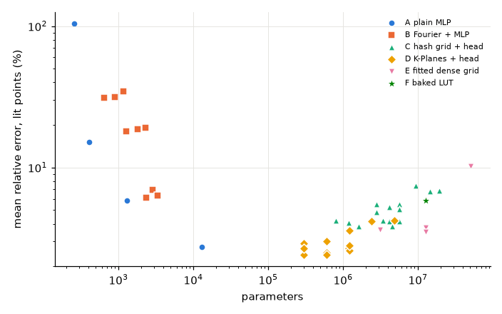
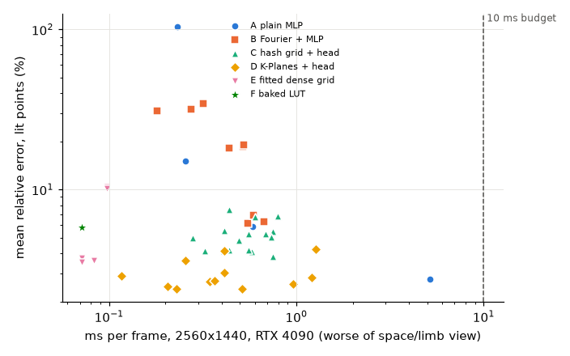
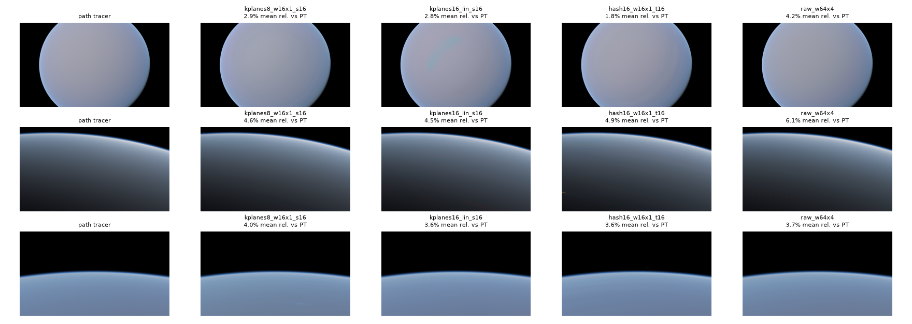
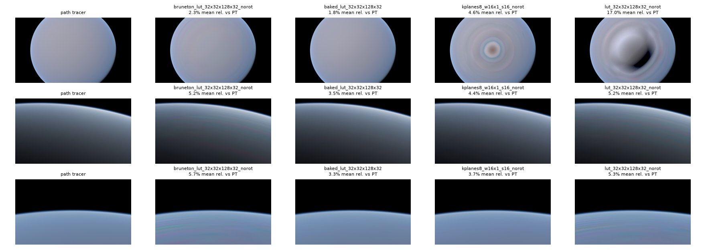

# Research: encoding study results

Quality side of [the encoding study](../plans/20261019-neural-encoding-study.md):
which representation of uvwz -> linear Rec.709 (symmetric scene) gives the
lowest error against clean references for its parameter count and inference
cost, trained on Monte Carlo noisy targets. Inference cost comes from
[the inference-cost study](20261019-neural-inference-cost.md) (`bench-neural`,
RTX 4090, 2560x1440; in the zs-neural-bench worktree until merged), joined by
configuration name.

## Answer

- **Ship K-Planes, F = 8 features, base 16, one hidden layer of 16 ReLU
  (`kplanes8_w16x1_s16`), fed u_mu rotated by half.** 301,507 parameters
  (0.58 MB at fp16), 0.23 ms per frame (rgba16f textures, constant-buffer
  head), mean relative error 2.4-2.7 % over lit reference values (three seeds),
  p99 21 %. No other learned family comes close at any cost:
  the hash grid's best is 3.8 %, the current 64x4 MLP 2.7 % at 3.6-5.2 ms,
  small MLPs and Fourier features 5.9-6.1 % or worse.
- **Every candidate is far below the 10 ms budget** (all small-head rows
  0.07-1.3 ms), so quality decides.
- **Rotate u_mu by half before any interpolating encoding.** u_mu = 0.5 splits
  rays that hit the ground (nadir side) from rays that do not (zenith side);
  interpolating across it paints a dark ring at the nadir of every view from
  space (renders below). `frac(u_mu + 0.5)` moves that discontinuity onto the
  domain edges. It is one line in the mlp mode's uvwz and changes no kernel.
  The endpoint-including LUT layout (two mu halves) solves the same problem for
  tables.
- **Baked LUT (F) vs learned:** on the clean reference points K-Planes at
  0.58 MB beats the 24 MB baked 32x32x128x32 LUT (2.4 % vs 5.8 %), but most
  of F's error sits in one place: the last nu cell (u_nu >= 0.968, +53 % bias),
  where the nu = 1 vertex stores the aureole peak (up to 1357) and linear
  interpolation smears it; elsewhere F is 3.9 %. On the rendered views, which
  never look near the sun, F is the best image (1.8 / 3.5 / 3.3 % mean
  relative error against the path tracer vs 2.9 / 4.6 / 4.0 % for K-Planes).
  A LUT with more nu resolution near nu = 1 would likely win outright on
  memory-unconstrained quality; at equal memory the learned methods do not
  beat it on the views tested.
- **Noise:** relative L2 with a detached denominator is required (MSE: 5.7 %
  K-Planes, 16 % hash, vs 2.4 % / 3.9 %). With 16x the target noise variance
  (1k paths instead of 16k) K-Planes degrades 2.3x, the hash grid 2.6x, the
  fitted dense grid 4.0x (pure noise scaling): K-Planes' factorization averages
  noise across the planes; dense tables do not.

## Setup

- Data: `train_16k.edgn` / `train_1k.edgn` (2^25 samples, 16,384 / 1,024
  paths), last 5 % of each held out as one contiguous chunk for monitoring;
  final metrics only on `ref_clean.edgn` (65,536 points, 2^22 paths).
  Training keeps negative targets. It drops two kinds of rows:
  - those whose ray looks into the sun disk (clamped nu above
    cos(sun angular radius)): 2 rows per file, radiance 3.3e6 / 2.4e6 against
    a next-highest sample of 1,055 / 1,197. One such sample dominated the
    whole loss.
  - the 8,155 rows with |u_mu - 0.5| < 1/8192, which no camera ray reaches
    (scattering_uvwz maps each mu half to texel-centre ranges); their inverse
    clamps to unrelated rays (straight up from 70 km: black next to a bright
    neighbour). Metrics leave these points out too (1 of the 65,536).
- Training: Adam (beta2 0.99, eps 1e-15), 2 % warmup then cosine to 1 %,
  batch 2^17 drawn uniformly from GPU-resident data, **300 s wall clock per
  run** (the step count is fixed from a timed probe so the schedule depends
  on steps). Learning rates 1e-2 for tables, planes, and heads (Instant-NGP /
  K-Planes practice) and for the plain and Fourier MLPs (3x better than 3e-3
  in a 60 s probe). K-Planes planes start uniform in [0.5, 1.5]: the paper's
  [0.1, 0.5] multiplies six planes down to ~1e-3.
- Loss: `((p - y)^2 / (p.detach()^2 + eps)).mean()`, eps = 1e-4: values below
  ~0.01 (1 % of the median radiance; the night side is ~1e-5) count as
  absolute, invisible at the renderer's exposures.
- Seed spread: `kplanes8_w16x1_s16` over seeds 0 / 1 / 2 gives 2.41 / 2.73 /
  2.59 %, the hash grid 3.86 / 4.25 %. Differences under ~0.3 points are noise.
- Encodings are defined exactly as `shaders/neural/*.slang` in the bench
  worktree evaluates them (hash primes and per-axis cell schedule
  (4, 8, 8, 4) -> (32, 512, 1024, 64), K-Planes plane layout, aligned-corner
  planes, Hadamard product, scale concatenation, Fourier feature order,
  f = 0.5), checked against `bench_neural_check.py`'s float64 reference
  (max error / RMS 1e-5 K-Planes, 1.3e-4 hash, 4e-5 MLP).

### Metrics

On `ref_clean`, predictions clamped at zero (the shipped head ends in ReLU):

- RMSE over all values: dominated by the bright forward peak (values to 300).
- mean rel.: mean |p - y| / y over lit values, per channel value with
  y > 0.01. A per-point relative error would explode on a near-zero channel
  beside two bright ones.
- p99 rel.: 99th percentile of the same.
- Regions (mean rel. over lit values): split |u_mu - 0.5| < 0.02 (nadir and
  zenith rays, the discontinuity), horizon |u_mu - 0.5| > 0.48 (grazing rays
  at both ends of u_mu), terminator |mu_s| < 0.05, forward u_nu > 0.995
  (nu > 0.99), sunset -0.05 < mu_s < 0.15.
- The relative L2 of the loss is not reported. A handful of near-black points
  dominate it.
- Noise floor: the 16k targets carry 5.2 / 2.9 / 2.3 % relative std (R/G/B);
  the reference 0.2-0.4 %.

## Results

Best rows per family (default settings: 16k data, relative loss, identity
output, u_mu rotated). ms is the worse of the bench's space and limb views
for the fastest benchmarked variant; `~` marks a stand-in row (same levels,
table and head, different cell schedule; or the nearest LUT size, as LUT cost
is flat in size). The full table is in the appendix.

| cand. | run | params | MB fp16 | mean rel. | p99 | split | horizon | terminator | forward | sunset | 1k/16k | ms |
| --- | --- | ---: | ---: | ---: | ---: | ---: | ---: | ---: | ---: | ---: | ---: | ---: |
| A | `raw_w64x4` (current net) | 12,995 | 0.02 | 2.74 % | 17.5 % | 3.8 % | 4.6 % | 3.3 % | 11.6 % | 3.0 % | | 3.9 (emlp) |
| A | `raw_w32x2` | 1,315 | 0.003 | 5.85 % | 36.9 % | 8.9 % | 7.8 % | 6.6 % | 25.2 % | 6.0 % | 1.11 | 0.59 |
| B | `fourier4_w32x2` | 2,339 | 0.005 | 6.14 % | 36.1 % | 8.9 % | 7.4 % | 7.4 % | 21.7 % | 6.6 % | 1.16 | 0.55 |
| C | `hash16_w16x1_t16` | 1,604,613 | 3.06 | 3.86 % | 35.5 % | 3.6 % | 4.3 % | 4.7 % | 13.1 % | 4.1 % | 2.59 | 0.75 |
| C | `hash16_w16x1_t18_coarse` | 4,569,885 | 8.72 | 3.83 % | 43.9 % | 4.6 % | 3.4 % | 4.2 % | 11.6 % | 3.8 % | | ~0.75 |
| D | **`kplanes8_w16x1_s16`** | 301,507 | 0.58 | **2.41 %** | 21.0 % | 2.6 % | 2.9 % | 2.8 % | 10.5 % | 2.6 % | 2.29 | 0.23 |
| D | `kplanes16_w32x1_s16` | 603,779 | 1.15 | 2.41 % | 24.2 % | 2.7 % | 2.7 % | 2.4 % | 12.0 % | 2.5 % | | 0.51 |
| D | `kplanes16_lin_s16` | 602,259 | 1.15 | 2.49 % | 28.8 % | 2.9 % | 3.0 % | 2.7 % | 13.0 % | 2.5 % | | 0.21 |
| D | `kplanes8_lin_s16` | 301,131 | 0.58 | 2.91 % | 24.4 % | 3.1 % | 3.7 % | 3.3 % | 12.1 % | 2.9 % | | 0.12 |
| E | `bruneton_lut_32x32x128x32` (fitted) | 12,582,912 | 24.0 | 3.73 % | 40.1 % | 4.5 % | 3.8 % | 4.0 % | 14.7 % | 3.6 % | 4.04 | ~0.07 |
| E | `lut_32x64x64x32` (fitted, rotated, aligned) | 12,582,912 | 24.0 | 3.52 % | 39.2 % | 4.8 % | 3.6 % | 3.8 % | 15.8 % | 3.5 % | | 0.07 |
| F | `baked_lut_32x32x128x32` | 12,582,912 | 24.0 | 5.83 % | 61.5 % | 9.3 % | 7.4 % | 7.4 % | 41.4 % | 5.7 % | | ~0.07 |

Pareto fronts (sweep rows only):




### Findings by family

- **A, plain MLPs.** Capacity-bound, not noise-bound (1k/16k ratio 1.11).
  4-32-3 does not fit at all (105 %); 4-16-16-3 15 %, 4-32-32-3 5.9 %. The
  64x4 reference reaches 2.7 % but costs 3.9 ms (runtime-shape `emlp`; 5.2 ms
  unrolled).
- **B, Fourier features.** No better than raw inputs with the same head;
  one hidden layer is far worse than two (18-19 % vs 6.1-6.9 %). L = 4 is
  as good as 6 or 8.
- **C, hash grid.** Overfits the noise: bigger tables are worse (2^16: 4.1 %,
  2^18: 5.3 %, 2^20: 6.8 % at 12 levels) and red, the noisiest channel, is
  worst. The benchmark's cell schedule reaches 1024 cells along mu, fewer
  than one sample per finest cell; a coarser schedule (16, 128, 256, 32)
  helps at 2^18 (5.3 -> 4.2 %, 12 levels). Linear heads lose the forward peak
  (22 %).
- **D, K-Planes.** Best family everywhere. Base resolution 16 beats 32
  (2.4 % vs 3.6-4.2 %: finer planes fit noise), and F = 8-16 with a 16-32
  head is the plateau. A 900 s run of the winner is no better (2.8 %); the
  error floor is the noise, not the budget.
- **E, fitted dense grid.** The endpoint-including layout with two mu halves
  (`bruneton_lut_*`, identical to `atmosphere/lut4d.slang` and the bake) fits
  to 3.7 %, the same as an aligned grid fed rotated u_mu. 16x64x256x64
  (50M parameters) has two training samples per vertex and fits their noise: 10 %. Without
  the rotation or the split, the aligned grid draws a dark band at the
  nadir (17 % on the default view).
- **F, baked LUT** (new endpoint bake, 65,536 paths, no sun disk): 5.8 %
  overall, 3.9 % for u_nu < 0.9, 58 % in the last nu cell. The fitted grid
  E beats it on reference points: least squares on random samples places
  vertex values that minimize the interpolation error between them, while
  the bake stores point values. Below u_nu = 0.9 it reads 2.4 % high on
  average: linear interpolation of a convex function.
- **Training on the LUT bake instead of random samples** hurts both learned
  grids (K-Planes 14.8 %, hash 8.8 %): 32 nu vertices and the aureole
  vertex leave everything between unconstrained.
- **Output activation:** softplus is no better than identity + ReLU-at-ship
  (K-Planes 2.51 vs 2.41 %, hash 4.27 vs 3.86 %), and the shader's output
  layer is ReLU, so identity training it is.

### Shipped precision

The bench ships K-Planes planes as rgba16f textures with hardware bilinear
filtering. Emulating it (fp16 planes and tables, bilinear weights rounded to
8 fractional bits, float32 heads; `study/shipped.py`) changes nothing
measurable: `kplanes8_w16x1_s16` 2.41 -> 2.42 % (p99 21.0 -> 21.2 %); its
outputs move by a median 0.05 % and a p99 0.6 % of the reference value. The
bench's random-weight check (median 2e-2, worst 2.0) overstates what trained
planes do. Hash (fp16 tables), the fitted grid, and the baked LUT
(rgba16f + 8-bit weights: 5.828 -> 5.829 %) are equally unaffected. The
bench measured that real filtering differs from the round-to-1/256 model by
about 1 % of output RMS, so this emulation is approximate.

## Renders

Per-pixel uvwz of each view computed as the mlp mode does
(`python/study/view_uvwz.py`, validated against `earth render --mode mlp` to
float32 precision with the same jittered rays), predictions clamped at zero,
tonemapped with exposure, clamp, and sRGB only (no OpenDRT), against the path
tracer at 65,536 spp (itself ~1-1.4 % noisy per pixel). Titles give the mean
relative error over lit atmosphere pixels. Views: the viewer's default,
`presets/sunset-hurricane.zon` (sunset limb), and the bench's limb view.





- K-Planes and the hash grid match the path tracer closely; the hash grid
  leaves isolated dark specks (sunset and limb views), `kplanes16_lin_s16` a
  faint green streak on the default view, `kplanes8_w16x1_s16` neither.
- The fitted dense grid shows its per-vertex noise as colour streaks; the
  baked LUT is the cleanest image.
- Unrotated, K-Planes and the aligned dense grid draw a dark ring or band at
  the nadir.

## Export

`python python/export_weights.py --run cache/study/runs/<run> --out <file.emlp>`
writes a run as an EMLP version 3 file (layout in `src/assets/Network.zig`),
which the renderer's `neural` mode loads; it checks the file against torch
first. The file's `mu_rotation` flag means uvwz.z = frac(uvwz.z + 0.5) before
the encoding.

## Caveats

- One seed per configuration except the winner (3) and the best hash (2);
  0.3-point differences are within seed noise.
- 300 s per run: big tables (hash 2^20, 50M-vertex grids) see fewer samples
  per parameter. The winner did not improve with 900 s.
- The region masks are coarse and overlap (sunset contains terminator).
- Coarse-schedule hash rows have no bench timing of their own (cost tracks
  levels and table size, not cells).
- The image metric includes the path tracer's own noise.

## Reproduce

```sh
pixi run -e py python python/encoding_study.py train kplanes8_w16x1_s16      # [--data 1k|lut] [--loss mse] [--output softplus] [--no-mu-rotation] [--seed N]
pixi run -e py python python/encoding_study.py baked-lut
pixi run -e py python python/encoding_study.py shipped kplanes8_w16x1_s16
pixi run -e py python python/encoding_study.py report                        # table + Pareto plots
pixi run -e py python python/encoding_study.py render kplanes8_w16x1_s16 --views default sunset_limb limb
```

Run names are the configuration (`python/study/configs.py`) plus every
setting that differs from the default.

## Appendix: all runs

| cand. | run | params | MB fp16 / fp32 | samples seen | RMSE | mean rel. (lit) R / G / B | p99 rel. | split | horizon | terminator | forward | sunset | 1k/16k | ms (bench variant) |
| --- | --- | ---: | ---: | ---: | ---: | ---: | ---: | ---: | ---: | ---: | ---: | ---: | ---: | --- |
| A | `raw_w64x4` | 12,995 | 0.02 / 0.05 | 16.39 G | 0.888 | 2.74% (3.2 / 2.4 / 2.6) | 17.5% | 3.8% | 4.58% | 3.28% | 11.59% | 2.99% |  | 5.17 (`raw_w64x4_gelu_staged`) |
| A | `raw_w32x2` | 1,315 | 0.00 / 0.01 | 59.45 G | 1.22 | 5.85% (6.4 / 5.4 / 5.8) | 36.9% | 8.9% | 7.84% | 6.63% | 25.20% | 6.02% | 1.11 | 0.59 (`raw_w32x2_gelu_const`) |
| A | `raw_w32x2_data1k` | 1,315 | 0.00 / 0.01 | 60.07 G | 1.27 | 6.48% (7.4 / 5.9 / 6.2) | 41.6% | 9.3% | 9.46% | 7.42% | 25.86% | 6.70% |  | 0.59 (`raw_w32x2_gelu_const`) |
| A | `raw_w32x2_norot` | 1,315 | 0.00 / 0.01 | 61.23 G | 1.31 | 7.86% (8.4 / 7.3 / 7.9) | 48.2% | 27.3% | 10.89% | 9.20% | 27.98% | 8.33% |  | 0.59 (`raw_w32x2_gelu_const`) |
| A | `raw_w16x2` | 403 | 0.00 / 0.00 | 78.20 G | 1.86 | 15.06% (16.4 / 14.1 / 14.7) | 94.9% | 35.3% | 19.52% | 18.29% | 40.85% | 16.07% |  | 0.26 (`raw_w16x2_gelu_const`) |
| A | `raw_w32x1` | 259 | 0.00 / 0.00 | 90.26 G | 3.84 | 104.52% (120.2 / 93.9 / 99.7) | 1412.9% | 148.7% | 80.81% | 104.24% | 113.98% | 101.75% |  | 0.23 (`raw_w32x1_gelu_const`) |
| B | `fourier4_w32x2` | 2,339 | 0.00 / 0.01 | 49.43 G | 1 | 6.14% (6.8 / 5.6 / 6.0) | 36.1% | 8.9% | 7.37% | 7.44% | 21.65% | 6.58% | 1.16 | 0.55 (`fourier4_w32x2_staged`) |
| B | `fourier8_w32x2` | 3,363 | 0.01 / 0.01 | 40.99 G | 0.936 | 6.34% (7.0 / 5.8 / 6.3) | 37.7% | 9.8% | 7.74% | 8.10% | 21.90% | 6.92% |  | 0.67 (`fourier8_w32x2_staged`) |
| B | `fourier6_w32x2` | 2,851 | 0.01 / 0.01 | 45.24 G | 1.08 | 6.93% (7.8 / 6.3 / 6.7) | 40.0% | 9.4% | 7.43% | 8.66% | 24.82% | 7.62% |  | 0.59 (`fourier6_w32x2_staged`) |
| B | `fourier4_w32x2_data1k` | 2,339 | 0.00 / 0.01 | 48.11 G | 1.04 | 7.11% (7.6 / 6.6 / 7.1) | 41.0% | 10.1% | 8.81% | 8.63% | 19.99% | 7.53% |  | 0.55 (`fourier4_w32x2_staged`) |
| B | `fourier4_w32x1` | 1,283 | 0.00 / 0.00 | 64.44 G | 1.69 | 18.08% (19.0 / 15.3 / 19.9) | 128.4% | 23.8% | 19.87% | 23.38% | 55.11% | 19.56% |  | 0.44 (`fourier4_w32x1_staged`) |
| B | `fourier6_w32x1` | 1,795 | 0.00 / 0.01 | 61.86 G | 1.78 | 18.61% (19.8 / 16.0 / 20.0) | 134.0% | 24.3% | 20.08% | 25.47% | 57.44% | 21.27% |  | 0.52 (`fourier6_w32x1_staged`) |
| B | `fourier8_w32x1` | 2,307 | 0.00 / 0.01 | 54.42 G | 1.88 | 19.15% (20.0 / 16.7 / 20.7) | 132.2% | 24.4% | 20.83% | 25.54% | 49.60% | 21.44% |  | 0.52 (`fourier8_w32x1_staged`) |
| B | `fourier4_w16x1` | 643 | 0.00 / 0.00 | 71.69 G | 2.27 | 30.99% (31.1 / 25.6 / 36.2) | 264.8% | 47.9% | 38.68% | 45.07% | 95.52% | 36.32% |  | 0.18 (`fourier4_w16x1_const`) |
| B | `fourier6_w16x1` | 899 | 0.00 / 0.00 | 66.16 G | 2.36 | 31.66% (34.6 / 24.4 / 36.0) | 274.7% | 37.7% | 35.88% | 45.14% | 95.32% | 37.22% |  | 0.27 (`fourier6_w16x1_const`) |
| B | `fourier8_w16x1` | 1,155 | 0.00 / 0.00 | 62.17 G | 2.48 | 34.57% (37.3 / 27.3 / 39.1) | 300.0% | 62.2% | 34.47% | 48.13% | 82.94% | 41.74% |  | 0.32 (`fourier8_w16x1_const`) |
| C | `hash16_w16x1_t18_coarse` | 4,569,885 | 8.72 / 17.43 | 4.36 G | 0.732 | 3.83% (5.7 / 2.9 / 3.0) | 43.9% | 4.6% | 3.35% | 4.20% | 11.64% | 3.82% |  | ~0.75 (`hash16_half_w16x1_global_t18`) |
| C | `hash16_w16x1_t16` | 1,604,613 | 3.06 / 6.12 | 4.45 G | 0.835 | 3.86% (5.3 / 3.3 / 3.0) | 35.5% | 3.6% | 4.27% | 4.68% | 13.14% | 4.05% | 2.59 | 0.75 (`hash16_half_w16x1_staged_t16`) |
| C | `hash12_w16x1_t16` | 1,204,277 | 2.30 / 4.59 | 5.94 G | 0.884 | 4.08% (6.2 / 3.2 / 2.9) | 47.5% | 4.0% | 4.38% | 4.39% | 14.02% | 4.00% |  | 0.58 (`hash12_half_w16x1_staged_t16`) |
| C | `hash12_lin_t18` | 4,169,663 | 7.95 / 15.91 | 5.91 G | 1.59 | 4.16% (5.0 / 3.8 / 3.7) | 39.6% | 2.7% | 6.29% | 5.10% | 22.13% | 4.65% |  | 0.32 (`hash12_half_lin_const_t18`) |
| C | `hash16_lin_t18` | 5,673,115 | 10.82 / 21.64 | 4.37 G | 1.59 | 4.17% (5.0 / 3.7 / 3.8) | 39.6% | 2.9% | 6.33% | 5.06% | 22.20% | 4.63% |  | 0.41 (`hash16_half_lin_const_t18`) |
| C | `hash12_w16x1_t18_coarse` | 3,422,725 | 6.53 / 13.06 | 5.85 G | 0.826 | 4.19% (6.9 / 3.2 / 2.5) | 52.0% | 5.0% | 3.64% | 4.91% | 15.52% | 4.39% |  | ~0.55 (`hash12_half_w16x1_const_t18`) |
| C | `hash8_w16x1_t16` | 806,397 | 1.54 / 3.08 | 8.82 G | 0.776 | 4.20% (5.7 / 3.5 / 3.4) | 38.1% | 3.6% | 5.17% | 4.64% | 14.41% | 4.18% |  | 0.44 (`hash8_half_w16x1_staged_t16`) |
| C | `hash16_w16x1_t16_seed1` | 1,604,613 | 3.06 / 6.12 | 4.44 G | 0.875 | 4.25% (6.4 / 3.4 / 3.0) | 47.4% | 4.1% | 4.26% | 4.74% | 14.67% | 4.40% |  | 0.75 (`hash16_half_w16x1_staged_t16`) |
| C | `hash16_w16x1_t16_softplus` | 1,604,613 | 3.06 / 6.12 | 4.45 G | 0.949 | 4.27% (7.9 / 2.7 / 2.3) | 43.2% | 4.4% | 3.58% | 4.39% | 20.88% | 4.16% |  | 0.75 (`hash16_half_w16x1_staged_t16`) |
| C | `hash8_w16x1_t18_coarse` | 2,305,141 | 4.40 / 8.79 | 8.71 G | 0.896 | 4.29% (6.7 / 3.3 / 3.0) | 48.2% | 4.7% | 4.09% | 4.98% | 13.24% | 4.45% |  | ~0.41 (`hash8_half_w16x1_const_t18`) |
| C | `hash12_w16x1_t18_coarse_norot` | 3,422,725 | 6.53 / 13.06 | 5.81 G | 0.879 | 4.52% (7.2 / 3.2 / 3.2) | 52.1% | 9.7% | 3.91% | 5.04% | 12.11% | 4.58% |  | ~0.55 (`hash12_half_w16x1_const_t18`) |
| C | `hash8_w32x1_t18` | 2,772,797 | 5.29 / 10.58 | 8.45 G | 0.829 | 4.85% (8.1 / 3.8 / 2.8) | 72.4% | 5.1% | 4.55% | 5.34% | 14.69% | 4.86% |  | 0.49 (`hash8_half_w32x1_staged_t18`) |
| C | `hash8_lin_t18` | 2,772,205 | 5.29 / 10.58 | 8.85 G | 1.61 | 4.98% (5.6 / 4.7 / 4.6) | 42.4% | 3.1% | 7.29% | 6.35% | 23.37% | 5.65% |  | 0.28 (`hash8_half_lin_const_t18`) |
| C | `hash16_w32x1_t18` | 5,674,171 | 10.82 / 21.65 | 4.27 G | 0.863 | 5.06% (8.5 / 3.8 / 3.0) | 75.3% | 5.6% | 5.09% | 5.24% | 13.77% | 4.66% |  | 0.73 (`hash16_float_w32x1_staged_t18`) |
| C | `hash12_w16x1_t18` | 4,170,039 | 7.95 / 15.91 | 5.79 G | 0.917 | 5.27% (9.0 / 3.9 / 3.0) | 77.0% | 5.8% | 4.52% | 6.23% | 17.31% | 5.40% |  | 0.55 (`hash12_half_w16x1_const_t18`) |
| C | `hash12_w32x1_t18` | 4,170,487 | 7.95 / 15.91 | 5.71 G | 0.896 | 5.28% (9.4 / 3.6 / 2.9) | 81.8% | 6.7% | 4.98% | 5.77% | 16.76% | 5.25% |  | 0.68 (`hash12_half_w32x1_staged_t18`) |
| C | `hash16_w16x1_t18` | 5,673,595 | 10.82 / 21.64 | 4.32 G | 0.917 | 5.51% (9.2 / 4.2 / 3.3) | 84.2% | 6.1% | 4.08% | 5.92% | 15.60% | 5.36% |  | 0.75 (`hash16_half_w16x1_global_t18`) |
| C | `hash8_w16x1_t18` | 2,772,477 | 5.29 / 10.58 | 8.68 G | 0.989 | 5.52% (9.2 / 3.9 / 3.5) | 70.5% | 6.2% | 4.83% | 6.27% | 20.84% | 5.54% |  | 0.41 (`hash8_half_w16x1_const_t18`) |
| C | `hash12_w16x1_t20` | 14,359,705 | 27.39 / 54.78 | 4.35 G | 0.963 | 6.80% (12.0 / 5.1 / 3.4) | 100.0% | 8.9% | 4.83% | 7.54% | 19.53% | 6.41% |  | 0.60 (`hash12_half_w16x1_staged_t20`) |
| C | `hash16_w16x1_t20` | 19,256,971 | 36.73 / 73.46 | 3.08 G | 0.871 | 6.86% (11.5 / 5.2 / 3.9) | 95.1% | 8.9% | 5.03% | 7.39% | 15.76% | 6.28% |  | 0.79 (`hash16_half_w16x1_staged_t20`) |
| C | `hash8_w16x1_t20` | 9,413,245 | 17.95 / 35.91 | 7.36 G | 1.04 | 7.49% (13.2 / 5.8 / 3.6) | 100.0% | 9.4% | 5.49% | 8.35% | 17.91% | 7.08% |  | 0.44 (`hash8_half_w16x1_staged_t20`) |
| C | `hash16_w16x1_t16_datalut` | 1,604,613 | 3.06 / 6.12 | 4.44 G | 4.9 | 8.77% (12.2 / 7.9 / 6.2) | 90.3% | 9.5% | 9.49% | 11.54% | 43.92% | 9.24% |  | 0.75 (`hash16_half_w16x1_staged_t16`) |
| C | `hash16_w16x1_t16_data1k` | 1,604,613 | 3.06 / 6.12 | 4.45 G | 0.872 | 10.00% (17.6 / 7.8 / 4.8) | 123.2% | 12.7% | 5.81% | 12.13% | 19.90% | 10.74% |  | 0.75 (`hash16_half_w16x1_staged_t16`) |
| C | `hash16_w16x1_t16_mse` | 1,604,613 | 3.06 / 6.12 | 4.45 G | 0.962 | 16.02% (19.8 / 13.6 / 14.7) | 213.7% | 17.3% | 11.80% | 15.17% | 28.30% | 12.65% |  | 0.75 (`hash16_half_w16x1_staged_t16`) |
| D | `kplanes16_w32x1_s16` | 603,779 | 1.15 / 2.30 | 4.46 G | 0.914 | 2.41% (3.8 / 2.0 / 1.4) | 24.2% | 2.7% | 2.66% | 2.44% | 11.95% | 2.50% |  | 0.51 (`kplanes16_texture_half_w32x1_staged_s16`) |
| D | `kplanes8_w16x1_s16` | 301,507 | 0.58 / 1.15 | 5.59 G | 0.994 | 2.41% (3.4 / 2.1 / 1.8) | 21.0% | 2.6% | 2.86% | 2.83% | 10.46% | 2.56% | 2.29 | 0.23 (`kplanes8_texture_half_w16x1_const_s16`) |
| D | `kplanes8_w16x1_s16_norot` | 301,507 | 0.58 / 1.15 | 6.32 G | 0.849 | 2.48% (3.3 / 2.2 / 1.9) | 20.8% | 5.1% | 3.36% | 2.87% | 12.40% | 2.63% |  | 0.23 (`kplanes8_texture_half_w16x1_const_s16`) |
| D | `kplanes16_lin_s16` | 602,259 | 1.15 / 2.30 | 4.64 G | 1.01 | 2.49% (3.9 / 1.9 / 1.7) | 28.8% | 2.9% | 2.97% | 2.68% | 12.97% | 2.46% |  | 0.21 (`kplanes16_texture_half_lin_const_s16`) |
| D | `kplanes8_w16x1_s16_softplus` | 301,507 | 0.58 / 1.15 | 6.60 G | 0.936 | 2.51% (4.1 / 1.8 / 1.6) | 18.1% | 2.2% | 4.01% | 2.28% | 12.95% | 2.32% |  | 0.23 (`kplanes8_texture_half_w16x1_const_s16`) |
| D | `kplanes8_w32x1_s16_norot` | 301,955 | 0.58 / 1.15 | 6.58 G | 0.759 | 2.54% (3.5 / 2.2 / 2.0) | 19.4% | 4.8% | 2.71% | 3.09% | 11.00% | 2.79% |  | 0.37 (`kplanes8_texture_half_w32x1_staged_s16`) |
| D | `kplanes32_w16x1_s16` | 1,205,827 | 2.30 / 4.60 | 2.72 G | 0.849 | 2.58% (4.1 / 2.1 / 1.5) | 30.0% | 2.6% | 4.86% | 2.39% | 18.09% | 2.56% |  | 0.97 (`kplanes32_texture_half_w16x1_global_s16`) |
| D | `kplanes8_w16x1_s16_seed2` | 301,507 | 0.58 / 1.15 | 6.51 G | 0.897 | 2.59% (3.6 / 2.3 / 1.9) | 19.5% | 2.7% | 2.99% | 2.68% | 12.63% | 2.76% |  | 0.23 (`kplanes8_texture_half_w16x1_const_s16`) |
| D | `kplanes32_lin_s16` | 1,204,515 | 2.30 / 4.59 | 2.74 G | 0.981 | 2.68% (4.5 / 2.0 / 1.6) | 35.5% | 3.1% | 3.13% | 2.74% | 11.34% | 2.63% |  | 0.34 (`kplanes32_texture_half_lin_const_s16`) |
| D | `kplanes8_w32x1_s16` | 301,955 | 0.58 / 1.15 | 6.40 G | 0.742 | 2.69% (3.6 / 2.5 / 2.0) | 17.3% | 6.8% | 6.76% | 3.03% | 12.44% | 3.23% |  | 0.37 (`kplanes8_texture_half_w32x1_staged_s16`) |
| D | `kplanes8_w16x1_s16_seed1` | 301,507 | 0.58 / 1.15 | 6.74 G | 1.08 | 2.73% (3.8 / 2.3 / 2.0) | 20.8% | 2.7% | 2.81% | 2.87% | 11.65% | 3.14% |  | 0.23 (`kplanes8_texture_half_w16x1_const_s16`) |
| D | `kplanes8_w16x1_s16_b900` | 301,507 | 0.58 / 1.15 | 19.93 G | 0.653 | 2.81% (3.8 / 2.6 / 2.1) | 19.9% | 4.3% | 3.39% | 3.90% | 10.10% | 3.17% |  | 0.23 (`kplanes8_texture_half_w16x1_const_s16`) |
| D | `kplanes32_w32x1_s16` | 1,207,427 | 2.30 / 4.61 | 2.72 G | 0.853 | 2.82% (4.8 / 2.1 / 1.6) | 34.9% | 6.7% | 3.05% | 3.09% | 10.82% | 2.79% |  | 1.21 (`kplanes32_texture_half_w32x1_global_s16`) |
| D | `kplanes8_lin_s16` | 301,131 | 0.57 / 1.15 | 6.38 G | 1.08 | 2.91% (3.9 / 2.5 / 2.3) | 24.4% | 3.1% | 3.65% | 3.29% | 12.05% | 2.91% |  | 0.12 (`kplanes8_texture_half_lin_const_s16`) |
| D | `kplanes16_w16x1_s16` | 602,947 | 1.15 / 2.30 | 4.54 G | 0.876 | 3.02% (5.2 / 2.4 / 1.5) | 24.5% | 2.8% | 2.94% | 2.70% | 111.62% | 2.46% |  | 0.41 (`kplanes16_texture_half_w16x1_staged_s16`) |
| D | `kplanes8_lin_s16_norot` | 301,131 | 0.57 / 1.15 | 6.53 G | 1.07 | 3.17% (3.9 / 2.9 / 2.7) | 30.4% | 16.6% | 3.45% | 3.57% | 12.89% | 3.21% |  | 0.12 (`kplanes8_texture_half_lin_const_s16`) |
| D | `kplanes8_w16x1_s32` | 1,204,675 | 2.30 / 4.60 | 8.99 G | 1.01 | 3.60% (5.6 / 3.0 / 2.2) | 40.3% | 5.0% | 3.16% | 3.74% | 16.87% | 3.34% |  | 0.26 (`kplanes8_texture_half_w16x1_staged_s32`) |
| D | `kplanes16_w16x1_s32` | 2,409,283 | 4.60 / 9.19 | 5.56 G | 1.14 | 4.17% (7.3 / 3.2 / 2.1) | 58.1% | 4.8% | 3.74% | 4.72% | 13.62% | 4.04% |  | 0.41 (`kplanes16_texture_half_w16x1_staged_s32`) |
| D | `kplanes32_w16x1_s32` | 4,818,499 | 9.19 / 18.38 | 3.05 G | 0.773 | 4.23% (8.0 / 2.7 / 2.1) | 70.9% | 5.0% | 3.18% | 4.26% | 14.38% | 3.77% |  | 1.27 (`kplanes32_texture_half_w16x1_staged_s32`) |
| D | `kplanes8_w16x1_s16_data1k` | 301,507 | 0.58 / 1.15 | 6.60 G | 1.02 | 5.52% (8.5 / 4.8 / 3.4) | 67.3% | 6.7% | 4.81% | 6.01% | 17.16% | 5.32% |  | 0.23 (`kplanes8_texture_half_w16x1_const_s16`) |
| D | `kplanes8_w16x1_s16_mse` | 301,507 | 0.58 / 1.15 | 6.58 G | 0.417 | 5.72% (6.1 / 5.3 / 5.8) | 75.3% | 5.2% | 7.11% | 7.27% | 14.00% | 5.26% |  | 0.23 (`kplanes8_texture_half_w16x1_const_s16`) |
| D | `kplanes8_w16x1_s16_datalut` | 301,507 | 0.58 / 1.15 | 6.65 G | 11.9 | 14.82% (31.3 / 8.0 / 5.5) | 86.0% | 6.1% | 58.86% | 13.22% | 66.48% | 14.77% |  | 0.23 (`kplanes8_texture_half_w16x1_const_s16`) |
| E | `lut_32x64x64x32` | 12,582,912 | 24.00 / 48.00 | 27.00 G | 1.25 | 3.52% (5.1 / 2.9 / 2.5) | 39.2% | 4.8% | 3.56% | 3.81% | 15.81% | 3.54% |  | 0.07 (`lut_32x64x64x32_half_filtered`) |
| E | `lut_8x32x128x32` | 3,145,728 | 6.00 / 12.00 | 51.77 G | 1.63 | 3.63% (4.9 / 3.3 / 2.7) | 39.6% | 2.5% | 5.01% | 4.20% | 23.16% | 3.81% |  | 0.08 (`lut_8x32x128x32_half_filtered`) |
| E | `bruneton_lut_32x32x128x32_norot` | 12,582,912 | 24.00 / 48.00 | 25.63 G | 1.24 | 3.73% (5.3 / 3.1 / 2.8) | 40.1% | 4.5% | 3.78% | 3.96% | 14.71% | 3.60% | 4.04 | 0.07 (`lut_32x64x64x32_half_filtered`) |
| E | `lut_32x32x128x32` | 12,582,912 | 24.00 / 48.00 | 24.25 G | 1.26 | 3.75% (5.3 / 3.2 / 2.8) | 41.0% | 4.5% | 3.65% | 3.96% | 14.88% | 3.63% |  | 0.07 (`lut_32x64x64x32_half_filtered`) |
| E | `lut_32x32x128x32_norot` | 12,582,912 | 24.00 / 48.00 | 27.34 G | 1.25 | 4.98% (6.5 / 4.4 / 4.1) | 44.9% | 42.8% | 3.80% | 4.31% | 14.90% | 4.15% |  | 0.07 (`lut_32x64x64x32_half_filtered`) |
| E | `lut_16x64x256x64` | 50,331,648 | 96.00 / 192.00 | 7.64 G | 1.53 | 10.21% (15.1 / 8.5 / 7.1) | 100.0% | 14.8% | 7.13% | 10.25% | 31.41% | 9.89% |  | 0.10 (`lut_16x64x256x64_half_filtered`) |
| E | `bruneton_lut_16x64x256x64_norot` | 50,331,648 | 96.00 / 192.00 | 7.57 G | 1.52 | 10.35% (15.5 / 8.6 / 7.1) | 100.0% | 14.7% | 8.12% | 10.48% | 34.11% | 10.11% |  | 0.10 (`lut_16x64x256x64_half_filtered`) |
| E | `bruneton_lut_32x32x128x32_data1k_norot` | 12,582,912 | 24.00 / 48.00 | 23.56 G | 1.23 | 15.08% (27.8 / 9.4 / 8.3) | 174.2% | 19.8% | 8.18% | 14.71% | 28.90% | 14.62% |  | 0.07 (`lut_32x64x64x32_half_filtered`) |
| F | `baked_lut_32x32x128x32` | 12,582,912 | 24.00 / 48.00 | 0.00 G | 5.53 | 5.83% (7.7 / 5.6 / 4.2) | 61.5% | 9.3% | 7.35% | 7.35% | 41.42% | 5.68% |  | 0.07 (`lut_32x64x64x32_half_filtered`) |
